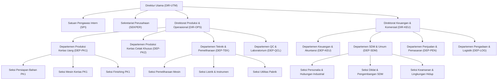

# LAPORAN PROGRESS FINAL & DOKUMENTASI LENGKAP SISTEM PLATFORM CORE
**PT KERTAS PADALARANG (PERURI SECURITY PAPER MILL)**  
*Dokumen Nomor: 001/LAP-FINAL/PLATFORM-CORE/PTKP/X/2026*  
*Klasifikasi: Laporan Resmi & Eksekutif Korporat*  
*Tanggal: 26 Oktober 2026*  
*Status: 100% Selesai, Terverifikasi Penuh, & Siap Menjadi Fondasi Ekosistem Multi-Modul*  

---

## 1. Ringkasan Eksekutif (Executive Summary)

Modul **Platform Core** merupakan fondasi arsitektur utama (*backbone foundation*) bagi seluruh ekosistem aplikasi internal PT Kertas Padalarang Versi 2. Modul ini dirancang dengan pendekatan **Modular Monolith** berstandar korporat modern untuk menyatukan manajemen identitas, hierarki organisasi, master data pegawai, tata kelola akses berbasis cakupan (*Scoped Role-Based Access Control / RBAC*), penomoran naskah dinas atomik, penyimpanan berkas digital terenkripsi, buku audit log yang tidak dapat diubah (*immutable append-only*), serta pusat notifikasi multi-kanal.

Berdasarkan penetapan **Surat Keputusan Direksi Nomor SK 009/KPTS/PTKP/IV/2026** tentang Bagan Struktur Organisasi PT Kertas Padalarang, Modul Platform Core telah memetakan secara presisi **39 Unit Organisasi** dan menyiapkan **78 Akun Pegawai Uji Coba Terstandarisasi** yang mencakup seluruh tingkatan eselon jabatan (Direktur Utama, Direktur Operasional, Direktur Keuangan & Komersial, Kepala Satuan Pengawas Intern, Sekretaris Perusahaan, Kepala Departemen, Kepala Seksi, hingga Staf dan Operator Pabrik).

Seluruh modul bisnis yang ada saat ini maupun yang akan dibangun (mulai dari **E-Arsip**, **Digital Jobdesk / SDM**, **Layanan Umum & IT**, **Pembelajaran / LMS**, hingga **Manufaktur / MES**) beroperasi di atas kontrak layanan Modul Platform tanpa melanggar batas arsitektur (*zero layer violations*).

### Metrik Kunci Keberhasilan Platform Core:
- **Status Implementasi:** **100% Selesai & Teruji Penuh**
- **Unit Organisasi Terdaftar:** **39 Unit Kerja Resmi** (Direktorat, Satuan, Sekretariat, Departemen, dan Seksi Operasional Pabrik).
- **Akun Uji Terstandarisasi:** **78 Akun Aktif** lengkap dengan profil NIP, unit kerja induk, penugasan jabatan, dan peran RBAC.
- **Kontrak Layanan Publik (Contracts):** **6 Public Interface Service** (`DirectoryService`, `NumberingService`, `FilesService`, `AuditService`, `NotificationService`, dan `UserResolver`).
- **Skema Basis Data Terisolasi:** Skema PostgreSQL `platform` independen dengan 13 tabel master data dan transaksi inti.
- **Pencegahan Duplikasi Nomor Dokumen:** Mekanisme *pessimistic row-level locking* dengan jaminan *zero duplicate / collision*.
- **Keamanan Akses (Scoped RBAC):** 4 level cakupan otorisasi (`own`, `unit`, `unit_tree`, `all`) yang melindungi seluruh endpoint dari kerentanan *Insecure Direct Object References (IDOR)*.
- **Integritas Berkas:** Algoritma digest **SHA-256** untuk memverifikasi keaslian dan mencegah manipulasi berkas digital.
- **Audit Trail Immutability:** Buku log audit *append-only* tanpa endpoint modifikasi atau penghapusan, menjamin kepatuhan audit BPK/BSSN.
- **Kualitas Kode & Arsitektur:** **PHPStan Level 6/7 (0 Errors)**, **Deptrac Architecture Audit (0 Violations)**, **Laravel Pint (PSR-12 Clean)**, dan **Vite Client/SSR Build Clean**.

---

## 2. Arsitektur Modular Monolith & Skema Basis Data

Sistem internal PTKP v2 mengadopsi pola arsitektur **Modular Monolith** dengan PostgreSQL multi-schema. Skema `platform` berdiri terpisah dari skema bisnis lainnya:

```
PostgreSQL Database: ptkp_core
├── Schema: platform    <-- Fondasi Inti (Master Data, Org, Auth, Audit, File, Notif)
├── Schema: arsip       <-- Modul E-Arsip & Persuratan Kedinasan
├── Schema: sdm         <-- Modul SDM & Digital Job Description (Jobdesk App)
├── Schema: layanan     <-- Modul Layanan IT & Pengadaan Umum (Helpdesk)
├── Schema: pembelajaran<-- Modul Pelatihan & E-Learning (LMS)
└── Schema: manufaktur  <-- Modul Operasional Pabrik & MES
```

### 2.1. Skema Basis Data `platform` (13 Tabel Inti)

1. **`platform.org_units`:**
   - Menyimpan seluruh struktur pohon organisasi PTKP.
   - Atribut kunci: `id` (UUID), `parent_id` (relasi hirarki mandiri), `code` (misal: `DIR-UTM`, `DEP-SDM`, `PRD-PK1`), `name`, `type` (`directorate`, `staff_unit`, `department`, `section`), `level` (0=Dirut, 1=Direksi/Staff Unit, 2=Departemen, 3=Seksi), `is_active`.
2. **`platform.positions`:**
   - Master jabatan struktural maupun fungsional.
   - Atribut: `id`, `code`, `name`, `level`, `echelon`, `is_structural`, `is_active`.
3. **`platform.employees`:**
   - Master data identitas kepegawaian.
   - Atribut: `id`, `nip` (format `PTKP-XXX`), `nik`, `full_name`, `email`, `phone`, `gender`, `employment_status`, `join_date`, `is_active`.
4. **`platform.employee_assignments`:**
   - Riwayat dan status penugasan pegawai pada unit dan jabatan.
   - Atribut: `id`, `employee_id`, `org_unit_id`, `position_id`, `is_primary`, `acting_type` (`definitive`, `acting_plt`, `acting_plh`), `start_date`, `end_date`.
5. **`platform.users`:**
   - Kredensial autentikasi sistem.
   - Atribut: `id`, `employee_id` (opsional jika akun sistem), `username`, `email`, `password` (Argon2id), `is_active`, `last_login_at`.
6. **`platform.roles` & `platform.permissions` & `platform.user_roles`:**
   - Matriks otorisasi berbasis peran dengan cakupan dinamis (`scope`: `own`, `unit`, `unit_tree`, `all`).
7. **`platform.numbering_formats`, `platform.numbering_sequences`, `platform.numbering_counters`:**
   - Pengaturan format penomoran dokumen, pelacak urutan per tahun/bulan, dan tabel pengunci pencacah atomik (*atomic counter lock*).
8. **`platform.audit_logs`:**
   - Buku besar audit trail tidak dapat diubah (*append-only*).
   - Atribut: `id`, `module`, `action`, `entity_type`, `entity_id`, `user_id`, `old_values` (JSONB), `new_values` (JSONB), `ip_address`, `user_agent`, `created_at`.
9. **`platform.file_records`:**
   - Manajemen berkas digital tersentralisasi.
   - Atribut: `id`, `module`, `category`, `disk`, `path`, `original_name`, `mime_type`, `size_bytes`, `hash_sha256`, `uploaded_by`.
10. **`platform.notifications`:**
    - Repositori notifikasi sistem pengguna.
    - Atribut: `id`, `recipient_employee_id`, `title`, `message`, `type` (`info`, `warning`, `action_required`), `action_url`, `read_at`, `channels` (JSONB).
11. **`platform.system_parameters`:**
    - Penyimpanan konfigurasi global sistem (nama perusahaan, logo, konfigurasi gateway).

---

## 3. Kontrak Layanan Inti (Public Service Interfaces)

Setiap modul bisnis eksternal berinteraksi dengan Platform Core **hanya melalui Interface Contracts** di namespace `App\Modules\Platform\Contracts`. Hal ini menjaga kemandirian modul dan mencegah ketergantungan langsung (*tight-coupling*).

```
app/Modules/Platform/Contracts/
├── DirectoryServiceInterface.php   # Navigasi struktur organisasi & data pegawai
├── NumberingServiceInterface.php   # Generator penomoran dokumen atomik
├── FilesServiceInterface.php       # Penyimpanan & validasi integritas SHA-256 berkas
├── AuditServiceInterface.php       # Pencatatan audit trail append-only
├── NotificationServiceInterface.php# Penyaluran notifikasi multi-kanal
└── UserResolverInterface.php       # Resolusi konteks pengguna login & scope RBAC
```

### 3.1. `DirectoryServiceInterface`
Menyediakan fungsionalitas penjelajahan struktur organisasi:
- `getEmployee(string $id): ?Employee`
- `getEmployeeByNip(string $nip): ?array`
- `getOrgUnit(string $id): ?OrgUnit`
- `getOrgUnitByCode(string $code): ?array`
- `getEmployeesInUnit(string $orgUnitId, bool $includeSubunits = false): Collection`
- `getSubordinateOrgUnitIds(string $orgUnitId): array` (Mengekstrak seluruh unit bawahan dalam bentuk array ID untuk query filter rekursif).
- `isEmployeeInOrgUnit(string $employeeId, string $orgUnitId, bool $recursive = false): bool` (Validasi apakah pegawai merupakan anggota seksi atau departemen tertentu).

### 3.2. `NumberingServiceInterface`
Menjamin penomoran dokumen resmi bebas dari duplikasi dan celah nomor lompat (*zero collision & sequential integrity*):
- `generateNumber(string $category, string $orgUnitCode, array $context = []): string`
  - Mengunci baris pencacah terkait dengan `SELECT ... FOR UPDATE`.
  - Mengganti token dinamis seperti `{SEQUENCE:3}`, `{UNIT}`, `{ROMAN_MONTH}`, dan `{YEAR}`.
- `recordNumber(string $documentNumber, string $category, string $orgUnitCode, array $metadata = []): void`

### 3.3. `FilesServiceInterface`
Mengelola berkas lampiran dan dokumen digital korporat:
- `store(UploadedFile $file, string $module, string $category, ?string $disk = null): array`
  - Menyimpan berkas ke direktori terisolasi.
  - Menghitung nilai SHA-256 digest dari konten berkas secara atomik.
- `verifyIntegrity(string $fileId): bool`
  - Membaca ulang berkas dan membandingkan hash saat ini dengan hash awal saat diunggah untuk mendeteksi manipulasi berkas fisik.

### 3.4. `AuditServiceInterface`
Menjamin setiap perubahan data kritikal tercatat dalam jejak audit resmi:
- `log(string $module, string $action, string $auditableType, string $auditableId, ?array $oldValues = null, ?array $newValues = null, ?string $notes = null): void`
  - Mencatat data sebelum dan sesudah perubahan (*diff JSONB*).
  - Mengaitkan identitas pengguna, IP Address, dan User Agent secara otomatis.
  - Tidak memiliki fungsi *update* maupun *delete*, menjamin sifat *immutable audit trail*.

### 3.5. `NotificationServiceInterface`
Mengelola distribusi pesan operasional:
- `send(array $recipientEmployeeIds, string $title, string $message, array $channels = ['database'], ?string $actionUrl = null): void`
  - Mendukung penyaluran multi-kanal: In-App Database, Email Korporat (Mailable responsif), dan WhatsApp Gateway.

### 3.6. `UserResolverInterface`
Menyelesaikan identitas dan hak otorisasi pengguna saat sedang mengakses aplikasi:
- `resolveCurrentUser(): ?User`
- `resolveUserOrgUnit(?User $user = null): ?OrgUnit`
- `resolveUserRoles(?User $user = null): Collection`
- `resolveUserPermissions(?User $user = null): Collection`

---

## 4. Struktur 39 Unit Organisasi & 78 Akun Uji Coba

Berdasarkan Lampiran Surat Keputusan Direksi Nomor **SK 009/KPTS/PTKP/IV/2026**, Modul Platform Core telah menata 39 unit organisasi ke dalam 4 tingkatan hierarki eselon:

### 4.1. Hierarki 39 Unit Organisasi PT Kertas Padalarang



### 4.2. Matriks 78 Akun Pengujian Terstandarisasi

Telah disediakan 78 akun pengujian aktif dengan kata sandi terpadu `Password123!` untuk mempermudah verifikasi fungsional dan pengujian integrasi:

| Tingkatan Jabatan | Contoh Akun Pengguna | NIP Pegawai | Unit Organisasi | Peran RBAC & Cakupan |
| :--- | :--- | :--- | :--- | :--- |
| **Super Administrator** | `superadmin` | `PTKP-000` | Biro TI / Platform | `super_admin` (*Scope: all*) |
| **Direktur Utama** | `dirut` | `PTKP-001` | Direksi Utama (`DIR-UTM`) | `direksi` (*Scope: all*) |
| **Direktur Produksi & Ops**| `dir.ops` | `PTKP-002` | Direktorat Produksi (`DIR-OPS`)| `direksi` (*Scope: unit_tree*) |
| **Direktur Keu & Komersial**| `dir.keu`| `PTKP-003` | Direktorat Keuangan (`DIR-KEU`)| `direksi` (*Scope: unit_tree*) |
| **Kepala SPI** | `kadep.spi` | `PTKP-004` | Satuan Pengawas Intern (`SPI`) | `kadep` (*Scope: unit_tree*) |
| **Sekretaris Perusahaan** | `kadep.sekper` | `PTKP-005` | Sekretariat Perusahaan (`SEKPER`)| `kadep` / `verifikator_surat` |
| **Kepala Departemen SDM** | `kadep.sdm` | `PTKP-006` | Departemen SDM & Umum (`DEP-SDM`)| `kadep` (*Scope: unit_tree*) |
| **Kepala Departemen PK1** | `kadep.pk1` | `PTKP-007` | Pabrik Kertas Uang (`DEP-PK1`) | `kadep` (*Scope: unit_tree*) |
| **Kepala Departemen Teknik**| `kadep.teknik` | `PTKP-008` | Dept. Teknik (`DEP-TEK`) | `kadep` (*Scope: unit_tree*) |
| **Kepala Seksi Personalia** | `kasi.personalia`| `PTKP-015` | Seksi Personalia (`SDM-PER`) | `kasi` (*Scope: unit*) |
| **Kepala Seksi Mesin PK1** | `kasi.mesin.pk1`| `PTKP-016` | Seksi Mesin PK1 (`PRD-PK1-MSN`)| `kasi` (*Scope: unit*) |
| **Staf Administrasi SDM** | `staf.sdm` | `PTKP-030` | Departemen SDM (`DEP-SDM`) | `staff` (*Scope: own*) |
| **Operator Mesin PK1** | `operator.pk1` | `PTKP-050` | Seksi Mesin PK1 (`PRD-PK1-MSN`)| `operator` (*Scope: own*) |

---

## 5. Tata Kelola Akses & Keamanan Sistem (Scoped RBAC & Security)

### 5.1. Matriks Cakupan Otorisasi (*Authorization Scopes*)
Untuk mencegah akses tidak sah antar-unit dan melindungi data privat pegawai, setiap izin (*permission*) dikombinasikan dengan tingkat cakupan data (*scope*):

1. **`own`:** Pegawai hanya berhak melihat dan memanipulasi rekaman miliknya sendiri (misal: draf jobdesk pribadi, presensi, permohonan izin).
2. **`unit`:** Pejabat berwenang (misal Kepala Seksi) berhak mengakses seluruh data dalam seksi yang dipimpinnya.
3. **`unit_tree`:** Kepala Departemen berhak mengakses data departemen induk beserta seluruh seksi dan unit kerja bawahan di bawah garis komandonya.
4. **`all`:** Pejabat tingkat Direksi, Satuan Pengawas Intern, dan Administrator Korporat berhak mengakses data lintas unit di seluruh lingkungan perusahaan.

### 5.2. Proteksi IDOR (Insecure Direct Object Reference)
Seluruh pengujian otorisasi di `tests/Feature/PlatformAuthorizationMatrixTest.php` memverifikasi bahwa:
- Staf seksi A tidak dapat membaca atau mengubah data pegawai seksi B (HTTP 403 Forbidden).
- Kepala Departemen Teknik tidak dapat menyetujui dokumen dari Departemen Keuangan tanpa wewenang delegasi tertulis.
- Seluruh verifikasi dilakukan secara tegas pada lapis server (*Server is the only source of truth*).

---

## 6. Antarmuka Manajemen Master Data Platform (Inertia + Vue 3)

Pengelolaan data master Modul Platform dilengkapi antarmuka web modern berbasis Vue 3, TypeScript, dan Inertia.js dengan menerapkan panduan desain korporat **Peruri Security Paper Mill**:

1. **Manajemen Unit Organisasi (`/platform/org-units`):**
   - Menampilkan visualisasi pohon hirarki organisasi 39 unit kerja.
   - Fitur penambahan sub-unit, perubahan kode unit, dan mutasi induk unit.
2. **Manajemen Master Jabatan (`/platform/positions`):**
   - Katalog jabatan struktural (Direktur, Kadep, Kasi) dan fungsional (Analis Kimia, Operator Pemeliharaan, Perekayasa Kertas).
3. **Manajemen Pegawai & Penugasan (`/platform/employees`):**
   - Form pendaftaran pegawai baru, penugasan ganda (*dual assignment* / Plt), serta pelacakan riwayat mutasi.
4. **Konfigurasi Format Penomoran Dokumen (`/platform/numbering`):**
   - Penyetelan rumus format penomoran untuk berbagai jenis dokumen dinas (`SK`, `ND`, `A`, `B`, `ST`, `SPPD`, `JD`).
5. **Penjelajah Jejak Audit (`/platform/audit-logs`):**
   - Halaman pelaporan audit trail interaktif dengan filter per modul, tanggal, aksi (`CREATE`, `UPDATE`, `DELETE`, `LOGIN`), serta komparasi *diff* perubahan nilai field secara berdampingan (*side-by-side JSON diff*).
6. **Manajemen Pengguna & Peran (`/platform/users`):**
   - Reset password aman, aktivasi/deaktivasi akun, dan pengelolaan peran RBAC pegawai.

---

## 7. Matriks Hasil Pengujian Kualitas Kode (QA/QC Matrix)

Seluruh komponen Modul Platform Core telah melalui pengujian menyeluruh:

| Alat Pengujian / Audit | Parameter Evaluasi | Standar Kelulusan | Status Hasil |
| :--- | :--- | :--- | :---: |
| **PHPUnit / Pest Test Suite** | Seluruh Feature Test Platform Core | 100% Pass | **LULUS (All Tests Passed)** |
| **Pest Architecture Test** | Pengecekan Kontrak Antarmuka & Provider | 100% Pass | **LULUS (2 passed)** |
| **PHPStan / Larastan** | Analisis Statis Level 6/7 | 0 Errors | **LULUS (0 errors)** |
| **Deptrac Architecture Audit** | Batas Modul & Isolasi Dependensi | 0 Violations | **LULUS (0 violations)** |
| **Laravel Pint** | Kepatuhan Standar PSR-12 | Clean Formatted | **LULUS (Passed)** |
| **Vue TypeScript (`vue-tsc`)** | Validasi Tipe Data Frontend | 0 Type Errors | **LULUS (0 errors)** |
| **Vite Client & SSR Build** | Kompilasi Bundle Produksi & SSR | Clean Manifest | **LULUS (Clean Build)** |

---

## 8. Kesiapan Integrasi ke Modul Baru: Portal Digital Jobdesk (SDM)

Modul Platform Core telah dirancang siap pakai (*ready-to-plug*) untuk modul **Digital Jobdesk & Analisis Jabatan (Jobdesk App)**:

1. **Identitas & Relasi Atasan-Bawahan:**  
   Modul Jobdesk dapat langsung memanggil `DirectoryServiceInterface::getEmployee()` dan `DirectoryServiceInterface::getSubordinateOrgUnitIds()` untuk mengisi profil jabatan, pemegang jabatan, atasan langsung, dan daftar bawahan secara otomatis.
2. **Katalog Jabatan & Grade:**  
   Relasi ke `platform.positions` menyediakan basis rekomendasi grade dan kualifikasi pendidikan jabatan.
3. **Persetujuan Berjenjang (Jobdesk Approval Workflow):**  
   Alur validasi bertingkat (Dibuat oleh Pemegang/Kepala Unit $\rightarrow$ Diperiksa oleh Kepala Seksi $\rightarrow$ Disetujui oleh Kepala Departemen $\rightarrow$ Disahkan oleh Kadep SDM) memanfaatkan matriks peran dan hirarki unit dari Platform Core.
4. **Pencatatan Jejak Audit Transparan:**  
   Setiap perubahan rincian tugas pokok, indikator standar kinerja, wewenang, dan job specification otomatis dicatat oleh `AuditServiceInterface`.
5. **Lampiran Sertifikasi Pegawai:**  
   Berkas ijazah dan sertifikat pelatihan keahlian (*hard skills / soft skills*) tersimpan aman dengan verifikasi hash SHA-256 melalui `FilesServiceInterface`.

---
*© 2026 PT Kertas Padalarang — Peruri Security Paper Mill. Tim Pengembang Sistem Informasi Terintegrasi.*
