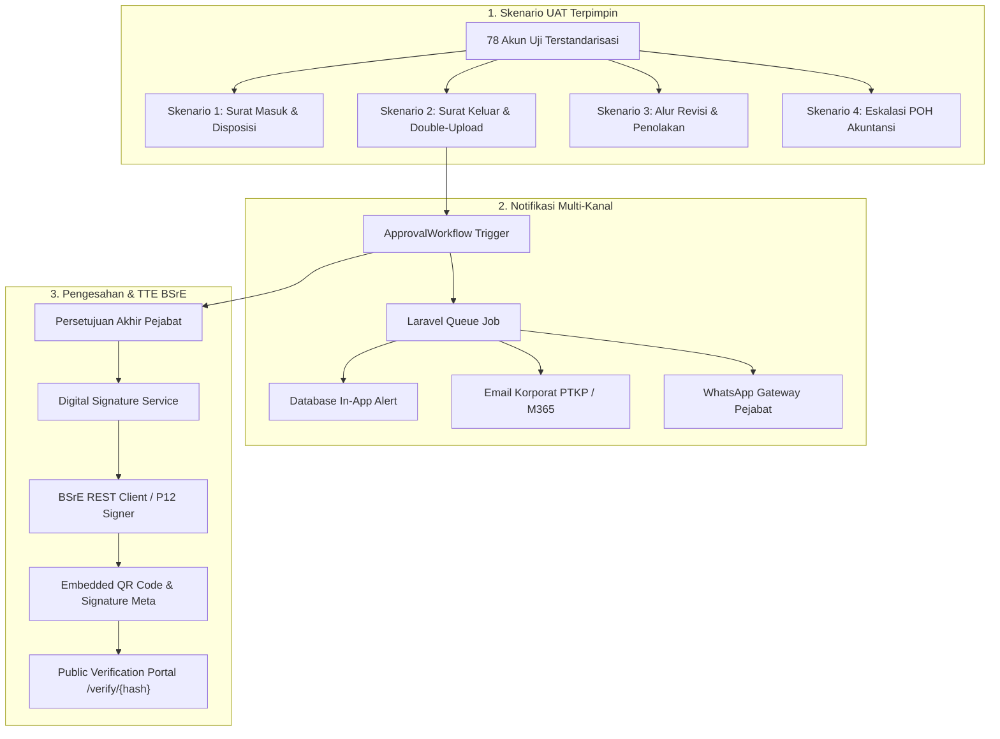

# Implementation Plan: UAT Terpimpin, Integrasi TTE BSrE, dan Notifikasi Multi-Kanal (WhatsApp & Email)

Dokumen ini merupakan rencana implementasi teknis dan operasional untuk **Fase 3 (Lanjutan)** pada ekosistem **E-Arsip PT Kertas Padalarang (PTKP)**, mencakup:
1. **Poin 1: Pelaksanaan User Acceptance Testing (UAT) Terpimpin & Uji Skenario Lapangan**
2. **Poin 3: Integrasi Tanda Tangan Elektronik Tersertifikasi (TTE BSrE / BSSN) & Verifikasi Dokumen Publik**
3. **Poin 4: Sistem Notifikasi Otomatis Multi-Kanal (WhatsApp Gateway & Email Korporat)**

---

## 1. Arsitektur & Hubungan Antar-Inisiatif



---

## 2. Rincian Teknis per Inisiatif

### INISIATIF 1: Pelaksanaan User Acceptance Testing (UAT) Terpimpin

#### 1.1. Tujuan & Sasaran
Memvalidasi bahwa sistem persuratan dapat digunakan secara mulus oleh para pemangku kepentingan (Direksi, Kepala Departemen, Kepala Seksi, dan Staf/Operator Pabrik) tanpa kendala operasional, serta memastikan keselarasan alur kerja nyata dengan SK Direksi No. SK 009/KPTS/PTKP/IV/2026.

#### 1.2. Pembagian Persona & Skenario Pengujian UAT

| Skenario | Persona Pelaksana | Akun Uji | Dokumen yang Diuji | Hasil yang Diharapkan |
| :--- | :--- | :--- | :--- | :--- |
| **UAT-01: Registrasi Surat Masuk & Disposisi** | Staf Sekretariat / Staf SDM & Direktur Utama | `stafsekretariat`<br>`superadmin`<br>`kasiepk1` | Surat Masuk (Kode B) dari Bank Indonesia | Surat terdaftar, file PDF pindaian tersimpan aman, disposisi bertingkat sampai ke pelaksana lapangan. |
| **UAT-02: Surat Keluar Dinas & Penomoran Atomik** | Operator Pabrik & Kepala Seksi & Kadep Produksi | `operatorpk1`<br>`kasiepk1`<br>`kadepprd` | Surat Keluar (Kode A) | Draf dibuat di form TipTap, melalui paraf berjenjang, nomor resmi tahunan terbit otomatis saat disahkan. |
| **UAT-03: Siklus Revisi Naskah (Rule 52)** | Staf Perencana & Kadep Teknik | `staftek`<br>`kadeptek` | Nota Dinas (Kode ND) | Kadep meminta perbaikan latar belakang anggaran $\rightarrow$ status `revision_requested` $\rightarrow$ staf edit naskah $\rightarrow$ alur persetujuan diulang dari bawah (step 1). |
| **UAT-04: Eskalasi POH Akuntansi** | Staf Akuntansi & Direktur Keuangan | `stafakt`<br>`dirkeu` | Surat Memo (Kode E) / SPB | Karena Kepala Departemen Akuntansi kosong, naskah otomatis dieskalasi ke Direktur Keuangan tanpa hambatan. |
| **UAT-05: Formulir Operasional Khusus** | Operator Mesin & Kadep SDM | `operatorblr`<br>`kadepsdm` | SPPD & Biaya Pengobatan (BP) | Penomoran bulanan reset otomatis, pengajuan klaim berobat terekam lengkap dengan rincian biaya. |
| **UAT-06: Uji Batas Hak Akses (Security & 403)** | Operator Pabrik | `operatorpk1` | Master Data Platform | Operator mencoba membuka URL `/platform/org-units` $\rightarrow$ ditolak oleh sistem dengan halaman Error 403 resmi PTKP. |

#### 1.3. Artefak & Instrumen UAT yang Disediakan
- **Panduan Pengujian Interaktif (UAT Handbook):** Dokumen panduan langkah-demi-langkah bagi peserta pengujian.
- **Formulir Lembar Uji & Feedback Digital (UAT Evaluation Sheet):** Kuesioner penerimaan sistem mencakup kemudahan antarmuka, kejelasan menu senior-friendly, dan kecepatan pratinjau PDF.
- **Berita Acara Serah Terima Uji Terima Pengguna (BAST UAT):** Dokumen legal pengesahan hasil uji terima.

---

### INISIATIF 2: Integrasi Tanda Tangan Elektronik (TTE BSrE / BSSN) & Verifikasi Dokumen Publik

#### 2.1. Latar Belakang & Kebutuhan Regulasi
Sesuai amanat UU ITE No. 11/2008 (dan perubahannya) serta standardisasi holding BUMN, naskah dinas resmi harus dijamin keaslian sumber (*authenticity*), keutuhan (*integrity*), dan nir-sangkal (*non-repudiation*). Kerja sama dengan **Balai Sertifikasi Elektronik (BSrE - BSSN)** memastikan dokumen PDF memiliki sertifikat digital yang diakui secara hukum di Indonesia.

#### 2.2. Arsitektur Teknis Penandatanganan Digital

```text
Alur Penandatanganan Digital:
[Naskah Disetujui] 
       │
       ▼
[LetterPdfService: Kompilasi PDF Final + QR Code Verifikasi]
       │
       ▼
[DigitalSignatureService]
       │
       ├── Mode A (Integrasi API BSrE): Kirim Digest SHA-256 ke Endpoint BSrE Cloud Signing
       │     └── Kembalikan PKCS#7 / PAdES Signature Container
       │
       └── Mode B (Lokal PFX/P12 Server-Side Signature): Penandatanganan via OpenSSL / SetPDF
             └── Sematkan Sertifikat Digital X.509 PTKP ke dalam Byte Stream PDF
       │
       ▼
[FilesService: Simpan signed_file_id di storage terproteksi]
       │
       ▼
[Update Status Surat: 'signed' / 'published']
```

#### 2.3. Komponen yang Akan Dibuat
1. **Layanan Abstraksi TTE (`app/Modules/Arsip/Services/DigitalSignatureService.php`):**
   - Menangani pembuatan hash dokumen (SHA-256).
   - Menghubungkan sistem ke server signing BSrE atau fallback modul penandatanganan P12.
   - Menyimpan metadata penandatanganan: *Signer NIP, Serial Number Sertifikat, Timestamp Authority (TSA), dan Signature Hash*.
2. **Penyematan QR Code Dinamis pada Template PDF:**
   - Memperbarui seluruh template Blade persuratan (`resources/views/arsip/templates/*.blade.php`) pada blok tanda tangan.
   - Menyertakan QR Code resmi berisi tautan verifikasi dokumen: `https://arsip.kertas-padalarang.co.id/verify/{document_hash}`.
3. **Portal Verifikasi Dokumen Publik (`resources/js/Pages/Public/VerifyDocument.vue`):**
   - Rute publik tanpa login: `GET /verify/{hash}`.
   - Menampilkan status keabsahan dokumen:
     - Nomor Surat Resmi, Tanggal Terbit, Perihal.
     - Pejabat Penandatangan & Jabatan Struktural.
     - Status Sertifikat: *Valid & Tersertifikasi BSrE BSSN*.
     - Indikator Integritas: *Dokumen asli, belum pernah dimodifikasi sejak ditandatangani*.

---

### INISIATIF 3: Notifikasi Otomatis Multi-Kanal (WhatsApp Gateway & Email Korporat)

#### 3.1. Latar Belakang & Urgensi
Pejabat penandatangan (Direksi, Kepala Departemen, Kepala Seksi) memiliki mobilitas tinggi di lingkungan pabrik kertas Padalarang yang luas (lini PK1, PK2, Boiler, Laboratorium). Notifikasi instan melalui WhatsApp dan Email korporat memastikan persetujuan naskah dinas tidak tertunda berhari-hari.

#### 3.2. Arsitektur Pengiriman Notifikasi Asynchronous

```text
Alur Notifikasi:
[ApprovalWorkflowService: Pengajuan Surat Baru / Revisi]
       │
       ▼
[NotificationService::send($recipientIds, $title, $message, ['database', 'mail', 'whatsapp'])]
       │
       ▼
[Laravel Database Queue Worker (Background Job: SendDispatchNotificationJob)]
       │
       ├── Channel 1: Database (Tabel platform.notifications untuk lonceng in-app)
       │
       ├── Channel 2: Email Korporat (Mailable: LetterApprovalRequiredMail)
       │     └── Dikirim via SMTP / Office 365 Exchange PTKP
       │
       └── Channel 3: WhatsApp Gateway (Driver: Qontak / Fonnte / Wablas API)
             └── Mengirim pesan template resmi berformat WhatsApp Markdown
```

#### 3.3. Spesifikasi Template Pesan WhatsApp
```text
*Pemberitahuan Persetujuan Naskah Dinas - E-Arsip PTKP*
--------------------------------------------------
Yth. Bapak/Ibu *{{ $approverName }}*,
*{{ $positionTitle }}*

Terdapat 1 naskah dinas baru yang membutuhkan persetujuan/paraf Anda:
• *Jenis Naskah:* {{ $letterTypeName }} ({{ $letterTypeCode }})
• *Perihal:* {{ $subject }}
• *Perancang:* {{ $creatorName }} ({{ $originUnitName }})
• *Tingkat Urgensi:* {{ $urgencyLabel }}
• *Tanggal:* {{ $letterDate }}

Silakan buka tautan berikut untuk memeriksa pratinjau dokumen dan memberikan keputusan:
🔗 {{ $approvalUrl }}

_Pesan otomatis dari Sistem Tata Kelola E-Arsip PT Kertas Padalarang_
```

#### 3.4. Spesifikasi Email Korporat
- Menggunakan layout email responsif berstandar **PTKP Brand Guidelines** (header Deep Navy `#141A5C`, logo resmi beresolusi tinggi, tombol aksi Call-to-Action warna Navy `#20288E` mengarah langsung ke halaman persetujuan).
- Menyertakan ringkasan isi surat dan lampiran draf PDF langsung di dalam email sebagai opsi baca cepat.

#### 3.5. Konfigurasi Driver Modular di `.env`
```env
# Konfigurasi Notifikasi WhatsApp
WHATSAPP_DRIVER=log # Pilihan: log, fonnte, qontak, wablas
WHATSAPP_API_URL=https://api.fonnte.com/send
WHATSAPP_API_TOKEN=your_token_here

# Konfigurasi Email
MAIL_MAILER=smtp
MAIL_HOST=smtp.office365.com
MAIL_PORT=587
MAIL_USERNAME=e-arsip@kertas-padalarang.co.id
MAIL_FROM_ADDRESS=e-arsip@kertas-padalarang.co.id
MAIL_FROM_NAME="E-Arsip PT Kertas Padalarang"
```

---

## 3. Matriks Perubahan & Rencana Berkas Baru

| Inisiatif | Kategori | Berkas Terkait | Aksi / Peran Berkas |
| :--- | :--- | :--- | :--- |
| **Inisiatif 1 (UAT)** | Dokumentasi | `dokumentasi/panduan-uat/Panduan_Pelaksanaan_UAT_E-Arsip.md` | Panduan skenario uji 6 peran pengguna |
| | Form / Instrument | `dokumentasi/panduan-uat/Formulir_Penilaian_UAT_PTKP.docx` | Formulir feedback dan berita acara |
| | Seeder | `app/Modules/Arsip/Database/Seeders/UatScenarioSeeder.php` | Seeder data simulasi naskah dinas siap uji |
| **Inisiatif 2 (TTE BSrE)** | Service | `app/Modules/Arsip/Services/DigitalSignatureService.php` | Pengelola integrasi sertifikat dan hash |
| | Controller Publik | `app/Modules/Arsip/Http/Controllers/PublicVerificationController.php` | Endpoint verifikasi publik `/verify/{hash}` |
| | Halaman Vue | `resources/js/Pages/Public/VerifyDocument.vue` | Tampilan status sertifikat dan metadata surat |
| | Templates | `resources/views/arsip/templates/*.blade.php` | Penyisipan komponen QR Code verifikasi |
| | Test | `tests/Feature/DigitalSignatureVerificationTest.php` | Pengujian integritas TTE dan rute verifikasi |
| **Inisiatif 3 (Notifikasi)** | Queue Job | `app/Modules/Platform/Jobs/SendDispatchNotificationJob.php` | Antrean pengiriman asynchronous |
| | Mailable | `app/Modules/Platform/Mail/LetterApprovalNotificationMail.php` | Template email resmi ber-kop PTKP |
| | Blade Email | `resources/views/emails/letter-approval.blade.php` | Layout responsif email brand PTKP |
| | Driver WA | `app/Modules/Platform/Services/Channels/WhatsAppChannel.php` | Client gateway WhatsApp (Fonnte/Qontak/Log) |
| | Test | `tests/Feature/MultiChannelNotificationTest.php` | Pengujian pengiriman email, WA, dan queue |

---

## 4. Rencana Tahapan Eksekusi (Phase 3 Roadmap)

```text
Minggu I : Implementasi Driver Notifikasi Multi-Kanal (Email & WhatsApp) + Queue Setup
Minggu II: Implementasi Modul TTE BSrE & Portal Verifikasi Publik Ber-QR Code
Minggu III: Penyusunan Dokumen Panduan UAT + UatScenarioSeeder
Minggu IV: Pelaksanaan UAT Terpimpin Bersama Pengguna Nyata & BAST Serah Terima
```

---

## 5. Kriteria Keberhasilan (Definition of Done)

1. **UAT Terpimpin:** Seluruh 6 skenario UAT selesai diuji oleh perwakilan pengguna, dengan nilai kepuasan pengguna minimal 85% dan tanpa ada temuan *critical bug*.
2. **TTE & QR Code:** Setiap naskah dinas yang disetujui menghasilkan berkas PDF dengan QR Code aktif; pemindaian QR Code menampilkan halaman verifikasi publik resmi yang memvalidasi integritas dokumen.
3. **Notifikasi Multi-Kanal:** Saat surat diajukan, verifikator menerima alert database, email korporat berformat rapi, dan pesan WhatsApp yang berisi tautan langsung ke naskah terkait.
4. **Kepatuhan Arsitektur:** Tetap lulus `composer qa` (0 pelanggaran Deptrac, 0 error PHPStan, 0 warning ESLint, dan test suite lulus 100%).
