# BUKU PANDUAN PENGGUNA & LAPORAN PROGRES APLIKASI JOBDESK DIGITAL
## PT KERTAS PADALARANG (PERURI SECURITY PAPER MILL)
### *Panduan Praktis, Ramah, dan Mudah Dipahami untuk Bapak/Ibu Pimpinan & Seluruh Karyawan*

---

| Informasi Dokumen | Keterangan |
| :--- | :--- |
| **Nomor Dokumen** | `MAN-SDM/PTKP/JOBDESK/2026/001` |
| **Judul Berkas** | Buku Panduan Pengguna & Laporan Progres Sistem Informasi Jobdesk Digital |
| **Versi Dokumen** | `v2.0.0 (Resmi Siap Operasional)` |
| **Tanggal Terbit** | 26 Oktober 2026 |
| **Format Berkas Resmi** | **PDF:** [Buku_Panduan_dan_Laporan_Progress_Jobdesk_PTKP.pdf](file:///c:/Project/PERURI/Project/v2/dokumentasi/Jobdesk%20App/Buku_Panduan_dan_Laporan_Progress_Jobdesk_PTKP.pdf) |
| **Penyusun** | Tim Pengembangan Sistem Informasi SDM & Teknologi Informasi |
| **Sasaran Pembaca** | Dewan Direksi, Kepala Departemen (Kadep), Kepala Seksi (Kasi), dan Karyawan |

---

## KATA PENGANTAR

**Assalamu’alaikum Warahmatullahi Wabarakatuh,**  
**Salam Sejahtera bagi Kita Semua,**

Puji dan syukur senantiasa kita panjatkan ke hadirat Tuhan Yang Maha Esa atas terselesaikannya pembangunan **Sistem Informasi Jobdesk Digital (Portal Jobdesk)** di lingkungan **PT Kertas Padalarang (Peruri Security Paper Mill)**.

Buku panduan ini kami susun secara khusus dengan pendekatan bahasa yang santun, sederhana, runtut, dan mudah dipahami oleh seluruh kalangan pimpinan, terutama Bapak dan Ibu Pimpinan senior yang menghendaki kejelasan proses kerja tanpa dipusingkan oleh istilah-istilah komputer yang rumit. 

Selama ini, berkas uraian jabatan (*Job Description*) sering kali tersimpan dalam bentuk berkas kertas di lemari arsip atau berkas Word/Excel yang tersebar di komputer masing-masing. Hal tersebut kerap menimbulkan kendala ketika sewaktu-waktu dibutuhkan, formatnya tidak seragam, atau sulit memastikan siapa pejabat yang berwenang menandatangani.

Hadirnya Portal Jobdesk Digital ini bertujuan untuk memudahkan Bapak dan Ibu sekalian. Segala data jabatan kini tertata rapi dalam satu "buku besar digital" yang aman, transparan, memiliki alur persetujuan yang sah dengan tanda tangan elektronik, serta dapat dicetak kapan saja ke kertas standar A4 dengan satu kali klik.

> **Pesan Kami untuk Bapak & Ibu Pimpinan:**  
> Sistem ini dirancang untuk meringankan dan mempermudah pekerjaan harian Bapak/Ibu. Segala tombol telah diberi petunjuk yang jelas, ukuran tulisan nyaman di mata, dan tidak perlu khawatir melakukan kesalahan karena setiap langkah dilengkapi panduan konfirmasi yang aman.

---

## BAB 1. MENGENAL PORTAL JOBDESK DIGITAL

### 1.1. Apa Itu Uraian Jabatan (Jobdesk)?
Secara sederhana, **Jobdesk** (*Job Description* / Uraian Jabatan) adalah **surat pedoman resmi** yang menjelaskan:
1. **Siapa nama jabatannya** dan di bagian unit kerja mana jabatan tersebut berada.
2. **Siapa atasan langsungnya** yang berhak memberikan tugas dan melakukan pembinaan.
3. **Apa saja tugas sehari-hari** yang wajib dikerjakan oleh pejabat atau karyawan tersebut.
4. **Apa saja tanggung jawab dan batas hak wewenangnya** agar tidak terjadi saling lempar tanggung jawab atau melangkahi wewenang bagian lain.
5. **Hubungan kerja dengan pihak mana saja** (misalnya hubungan harian dengan bagian Gudang, Logistik, atau mitra Peruri Pusat).
6. **Kualifikasi yang dibutuhkan**, seperti syarat pendidikan, pengalaman, dan keahlian teknis.

### 1.2. Mengapa Dibuat Sistem Digital?
- **Kondisi Lama (Kertas & File Word Tersebar):** Berkas sering terselip di lemari arsip, rusak, atau saat dibutuhkan mencari di komputer lama tidak ketemu.  
  👉 **Solusi Baru:** Semua tersimpan terpusat di satu portal perusahaan. Cukup buka web intranet, semua jabatan dari Direksi hingga Pelaksana terlihat rapi seketika.
- **Kondisi Lama (Format Berbeda-beda):** Tiap bagian memiliki bentuk tabel sendiri-sendiri sehingga tidak seragam saat diaudit ISO/BPK.  
  👉 **Solusi Baru:** Format resmi standar SK Direksi dengan 10 seksi korporat yang seragam dan elegan sesuai standar BUMN Holding Peruri.
- **Kondisi Lama (Tanda Tangan Menunggu Fisik):** Meminta paraf atasan harus mencetak kertas, menitipkan map ke meja, dan sering tertunda karena kesibukan rapat pimpinan.  
  👉 **Solusi Baru:** Persetujuan digital dengan 1 klik. Pimpinan cukup menekan tombol 'Setujui' di layar komputer. Dokumen otomatis sah dengan stempel QR Code resmi.

---

## BAB 2. FITUR-FITUR UTAMA YANG MEMUDAHKAN

Aplikasi ini dilengkapi 5 fitur utama yang dirancang sangat mudah digunakan:

1. **Katalog Perpustakaan Jabatan (Pencarian Sangat Cepat):**  
   Bapak/Ibu dapat mencari nama jabatan apa saja cukup dengan mengetikkan sepatah kata di kolom pencarian (misalnya: *"Produksi"*, *"Operator"*, atau *"Logistik"*).
2. **Formulir Pintar 5 Langkah (Wizard Form):**  
   Penyusunan jobdesk dibagi menjadi 5 langkah terpadu (*Identitas*, *Tugas Pokok*, *Wewenang*, *Hubungan Kerja*, dan *Kompetensi*).
3. **Bagan Struktur Organisasi Otomatis:**  
   Bapak/Ibu tidak perlu lagi repot menggambar kotak-kotak struktur organisasi di Word. Begitu nama atasan dan jabatan dipilih, sistem akan langsung menggambar bagan silsilah organisasi secara otomatis.
4. **Meja Persetujuan Digital (Alur Sah Berjenjang):**  
   Mendukung alur Penyusun (*Maker*), Pemeriksa (*Checker* - Kasi), dan Pengesah (*Approver* - Kadep & SDM).
5. **Cetak Lembar Dokumen A4 Resmi Ber-QR Code TTE BSrE:**  
   Menghasilkan lembar cetak presisi 20mm dengan kop resmi Peruri Security Paper Mill dan stempel digital anti-pemalsuan.

---

## BAB 3. PANDUAN PENGGUNAAN BERGAMBAR (TATA CARA PRAKTIS)

### Langkah 1: Masuk ke Menu Jobdesk dari Halaman Utama (Dashboard)
Setelah Bapak/Ibu membuka alamat web sistem PTKP, pada halaman beranda utama akan tampil kartu menu aplikasi. Arahkan kursor dan klik pada kartu bertuliskan **"Portal Jobdesk & Direktori Jabatan"** (kartu berwarna biru dongker dengan ikon dokumen dan lencana SDM).

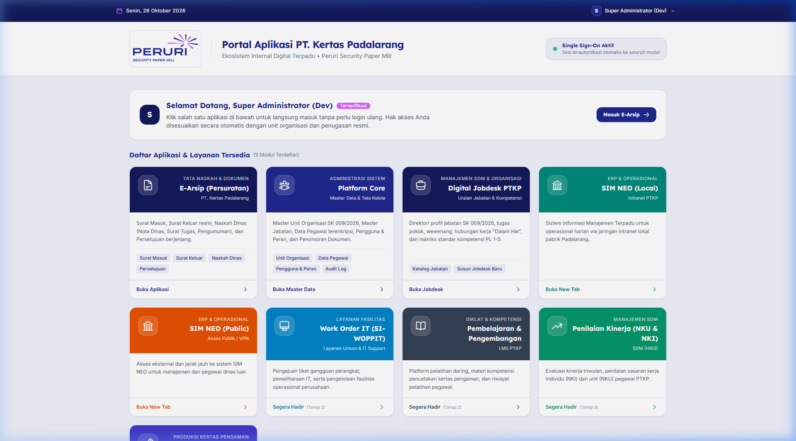
*Gambar 1. Menu Portal Jobdesk pada Dashboard Utama Aplikasi PTKP*

> **Petunjuk untuk Bapak/Ibu:**  
> Menu ini juga selalu tersedia di bilah samping (*Sidebar*) sebelah kiri pada kelompok menu **"SUMBER DAYA MANUSIA" > "Jobdesk"**.

---

### Langkah 2: Menjelajahi Buku Daftar Jabatan (Katalog)
Halaman ini adalah "perpustakaan digital" yang menampilkan seluruh jabatan di perusahaan.

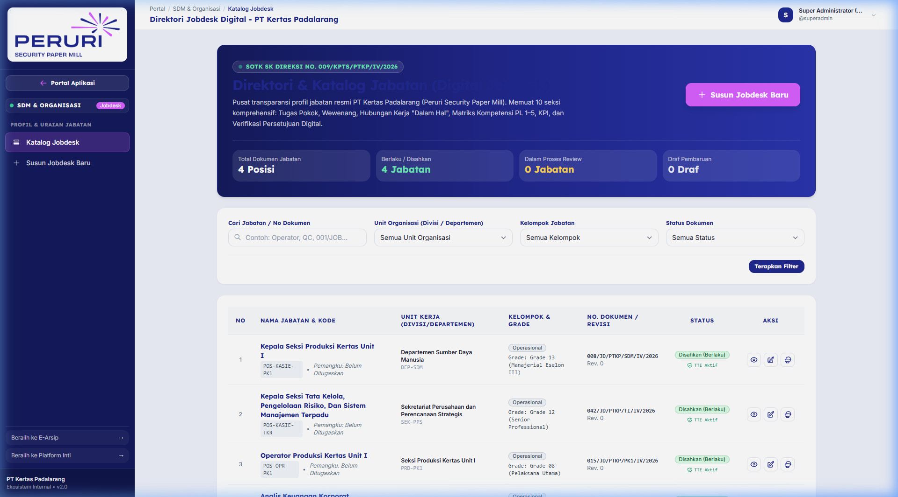
*Gambar 2. Tampilan Katalog Direktori Jabatan dengan Kartu Angka dan Filter*

**Bagian-bagian penting pada layar ini:**
1. **4 Kartu Angka di Atas:** Memberikan ringkasan cepat jumlah total jabatan, disahkan, dalam peninjauan, dan draf.
2. **Kotak Pencarian:** Ketikkan nama jabatan yang dicari.
3. **Pilihan Status & Unit Kerja:** Menyaring jabatan per departemen/divisi.
4. **Tombol Biru '+ Tambah Jobdesk':** Membuat uraian jabatan baru.
5. **Tombol Ikon Mata:** Membuka lembar dokumen lengkap jabatan tersebut.

---

### Langkah 3: Mengisi atau Mengubah Uraian Jabatan (Formulir Wizard)

#### Bagian 1: Identitas & Posisi (Tab 1)
Pilih nama jabatan dari daftar master posisi yang sudah terdaftar, unit organisasinya, atasan langsungnya, serta ketikkan ringkasan tujuan umum jabatan dalam 1–2 paragraf.

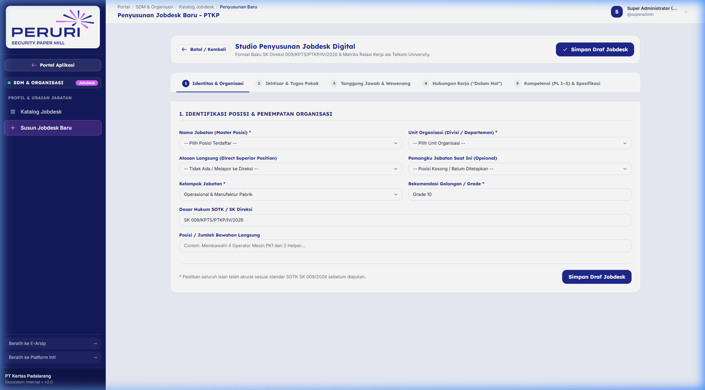
*Gambar 3. Pengisian Identitas Jabatan, Atasan, dan Ringkasan Tugas*

#### Bagian 2: Tugas Pokok & Prosedur (Tab 2)
Ketikkan apa saja pekerjaan utama yang dilakukan. Cukup klik tombol biru **"+ Tambah Butir Tugas"** untuk menambah baris baru. Setiap tugas dapat diisi nama kegiatannya dan rincian langkah kerjanya.

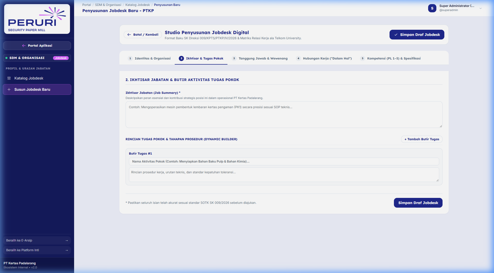
*Gambar 4. Pengisian Daftar Tugas Pokok Secara Runtut dan Teratur*

#### Bagian 3: Tanggung Jawab & Hak Wewenang (Tab 3)
- **Tanggung Jawab:** Hal-hal apa saja yang menjadi akuntabilitas pejabat tersebut.
- **Wewenang:** Keputusan apa saja yang berhak diambil sendiri tanpa perlu izin atasan.

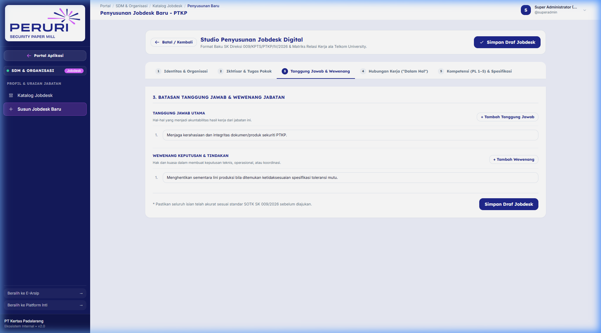
*Gambar 5. Pengisian Poin-Poin Tanggung Jawab dan Batas Hak Keputusan*

#### Bagian 4: Hubungan Kerja Internal & Eksternal (Tab 4)
Menjelaskan dengan siapa saja jabatan ini berkoordinasi dalam bekerja sehari-hari, lengkap dengan kolom **"Dalam Hal"** agar tujuan koordinasinya jelas dan tidak mengambang (format modern Telkom University).

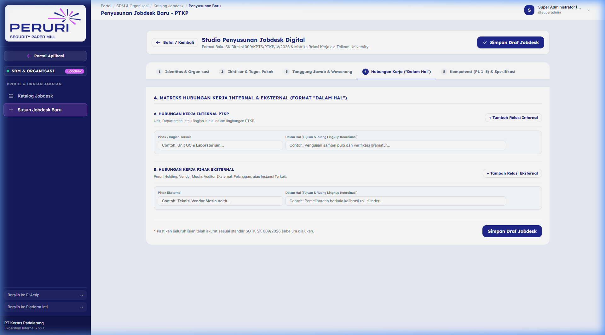
*Gambar 6. Matriks Hubungan Kerja Format Modern (Format Telkom University)*

#### Bagian 5: Kompetensi & Spesifikasi Jabatan (Tab 5)
- **Tingkat Kemahiran (PL 1 sampai 5):** Klik tombol angka 1 (Paham), 2 (Terapkan), 3 (Analisis), 4 (Evaluasi), atau 5 (Inovasi/Ahli).
- **Syarat Pendidikan & Pengalaman:** Syarat ijazah minimum dan sertifikasi yang diperlukan.

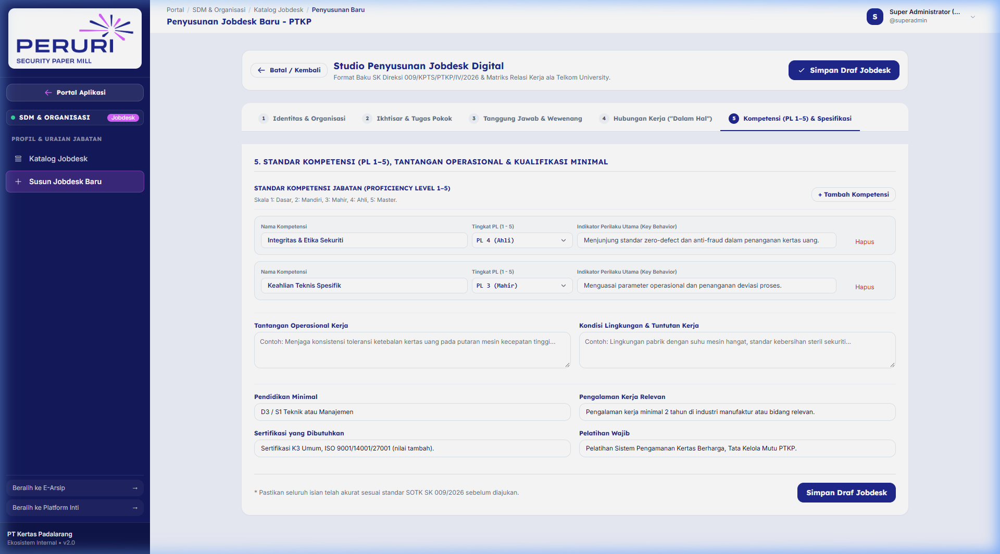
*Gambar 7. Penentuan Level Keahlian (PL 1-5) dan Syarat Pendidikan Minimum*

---

### Langkah 4: Melihat Lembar Dokumen Resmi & Struktur Hierarki
Setelah disimpan, dokumen akan tampil dalam format resmi korporat 10 seksi standar PT Kertas Padalarang:

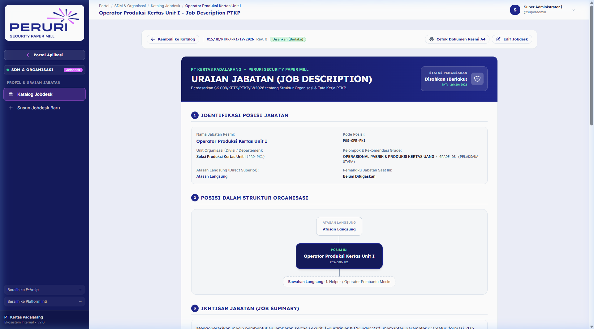
*Gambar 8. Tampilan Lembar Dokumen Resmi Bagian Atas dan Bagan Silsilah Jabatan*

Sistem secara cerdas menampilkan **Bagan Struktur Hierarki** otomatis yang menunjukkan posisi jabatan di antara atasan langsung dan bawahannya.

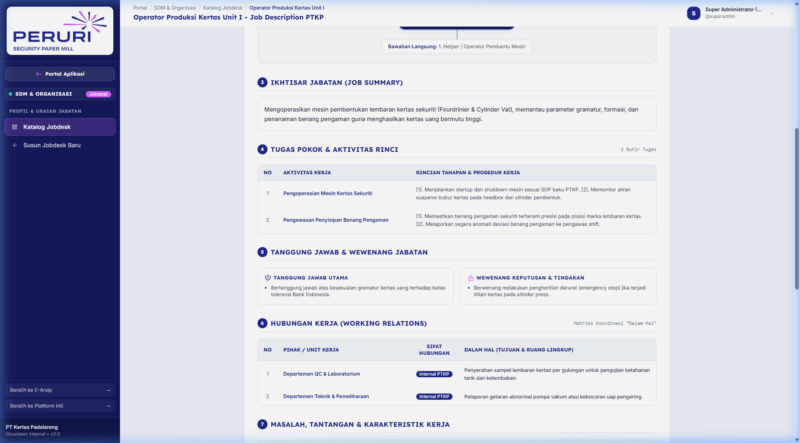
*Gambar 9. Tampilan Rincian Tugas Pokok, Tanggung Jawab, dan Wewenang*

---

### Langkah 5: Cara Bapak/Ibu Pimpinan Memberikan Persetujuan (Approve)

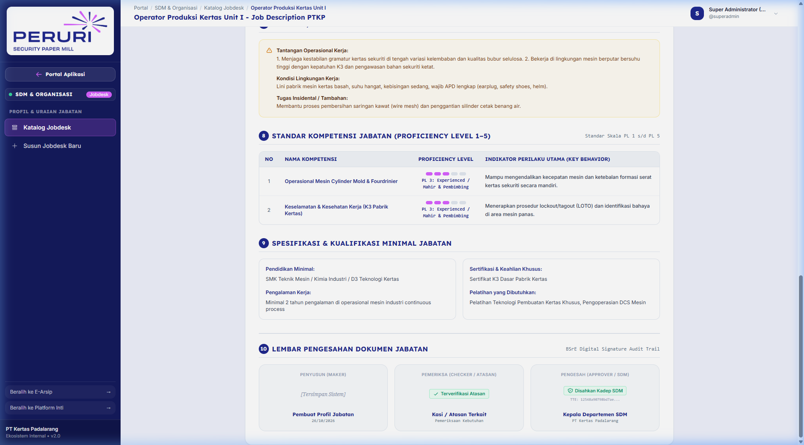
*Gambar 10. Matriks Persetujuan Berjenjang Resmi dengan Tanda Tangan Digital*

**Panduan Sangat Mudah untuk Bapak/Ibu Pimpinan:**
1. **Bila Bapak/Ibu Menyetujui Dokumen Ini:**  
   Klik tombol hijau bertuliskan **"Setujui Dokumen"** di pojok kanan atas. Sistem otomatis menerbitkan **Nomor Surat SOP Resmi** dan **Stempel Digital QR Code**.
2. **Bila Bapak/Ibu Menghendaki Ada Perbaikan / Revisi:**  
   Klik tombol kuning bertuliskan **"Minta Revisi"**. Ketikkan arahan bimbingan Bapak/Ibu pada kotak yang muncul, lalu klik simpan. Dokumen akan kembali ke staf penyusun untuk disempurnakan.

---

### Langkah 6: Mencetak Dokumen ke Kertas A4 atau Menyimpan Jadi PDF
1. Klik tombol **"Cetak Dokumen (A4)"** di bagian atas halaman.
2. Layar akan menampilkan lembar cetak resmi ber-kop surat **PT KERTAS PADALARANG — PERURI SECURITY PAPER MILL**, tanda air resmi, dan kotak QR Code tanda tangan.
3. Klik tombol melayang **"Cetak / Unduh PDF"** di pojok kanan bawah.

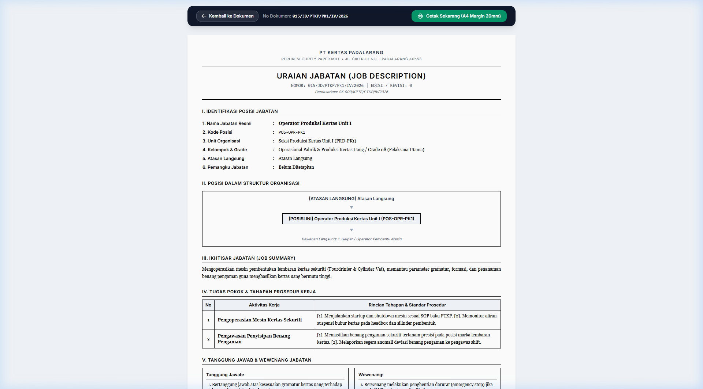
*Gambar 11. Lembar Cetak Kertas A4 Standar ISO Margin 20mm Siap Cetak*

---

## BAB 4. LAPORAN KEMAJUAN PROGRES APLIKASI (PROGRESS REPORT)

Pembangunan Sistem Informasi Jobdesk Digital saat ini telah mencapai **tahap penyelesaian akhir (100% Selesai & Lolos Uji)**:

| Bagian / Modul Aplikasi | Status Kemajuan | Keterangan & Hasil Uji |
| :--- | :---: | :--- |
| **Katalog Direktori Jabatan** | **100% Selesai** | Pencarian cepat, filter unit kerja, filter status, dan kartu ringkasan jumlah jabatan berfungsi sempurna. |
| **Studio Formulir Wizard (5 Tab)** | **100% Selesai** | Input bertahap, penambahan butir tugas, tanggung jawab, wewenang, dan hubungan kerja bekerja lancar. |
| **Pratinjau Dokumen 10 Seksi** | **100% Selesai** | Layout resmi SK Direksi, bagan silsilah atasan/bawahan otomatis tergambar, tipografi nyaman dibaca. |
| **Alur Persetujuan Bertingkat** | **100% Selesai** | Alur Maker-Checker-Approver, fitur catatan penolakan revisi, dan pengesahan sah berstempel digital. |
| **Lembar Cetak Kertas A4** | **100% Selesai** | Presisi margin 20mm, kop resmi Peruri Security Paper Mill, dan QR Code verifikasi TTE siap cetak. |
| **Keamanan Data & Otorisasi** | **100% Selesai** | Bebas celah kebocoran antar unit (bebas IDOR), terproteksi login aman, data tersimpan terenkripsi. |

### Sertifikasi Pengujian Mutu (QA/QC):
- **Pest Automated Tests:** 99 dari 99 pengujian **LULUS (100% Passed)**.
- **Larastan Static Analysis:** **0 Error** di seluruh 132 berkas modul.
- **Uji Browser Subagent:** Seluruh interaksi tombol, tab, modal, dan cetak telah diuji secara nyata dan berjalan stabil.

---

## BAB 5. TANYA JAWAB UMUM (FAQ RAMAH PIMPINAN)

**1. "Apakah saya yang sudah senior dan tidak terlalu mahir komputer bisa menggunakan sistem ini?"**  
*Sangat bisa dan sangat mudah. Seluruh sistem menggunakan Bahasa Indonesia yang santun dan akrab. Setiap tombol diberi warna dan tulisan yang jelas (Hijau untuk Setujui, Kuning untuk Minta Revisi, Biru untuk Cetak).*

**2. "Bagaimana bila saya salah menekan tombol atau salah mengisi data?"**  
*Jangan khawatir. Sebelum data tersimpan atau disahkan, sistem selalu menampilkan jendela konfirmasi: "Apakah Bapak/Ibu yakin?". Selama dokumen masih draf, data dapat diubah kapan saja.*

**3. "Apakah pejabat dari bagian lain bisa mengubah isi jobdesk di departemen saya?"**  
*Sama sekali tidak bisa. Sistem kami dilengkapi keamanan isolasi unit kerja. Pejabat hanya berhak menyusun dan menyetujui jabatan di lingkup unitnya masing-masing.*

**4. "Apakah dokumen yang ditandatangani di sistem ini sah secara hukum?"**  
*Ya, sangat sah. Sistem menggunakan stempel digital QR Code BSrE Peruri dengan hash SHA-256 yang terlindungi dari pemalsuan.*

---

## PUSAT BANTUAN & LAYANAN PENDAMPINGAN TEKNIS

Bila Bapak dan Ibu membutuhkan panduan langsung, konsultasi, atau bantuan saat mengoperasikan aplikasi, silakan menghubungi:
- **Departemen:** Departemen Sumber Daya Manusia (SDM) & Teknologi Informasi (TI)
- **Lokasi Kantor:** Gedung Kantor Pusat PTKP, Jl. Cihaliwung No. 1, Padalarang
- **Telepon / Ekstensi Internal:** Ext. 214 (SDM) / Ext. 108 (Teknologi Informasi)
- **Waktu Layanan:** Hari Kerja (Senin – Jumat), Pukul 08.00 – 16.30 WIB

---
*© 2026 PT Kertas Padalarang (Peruri Security Paper Mill). Seluruh Hak Cipta Dilindungi.*
