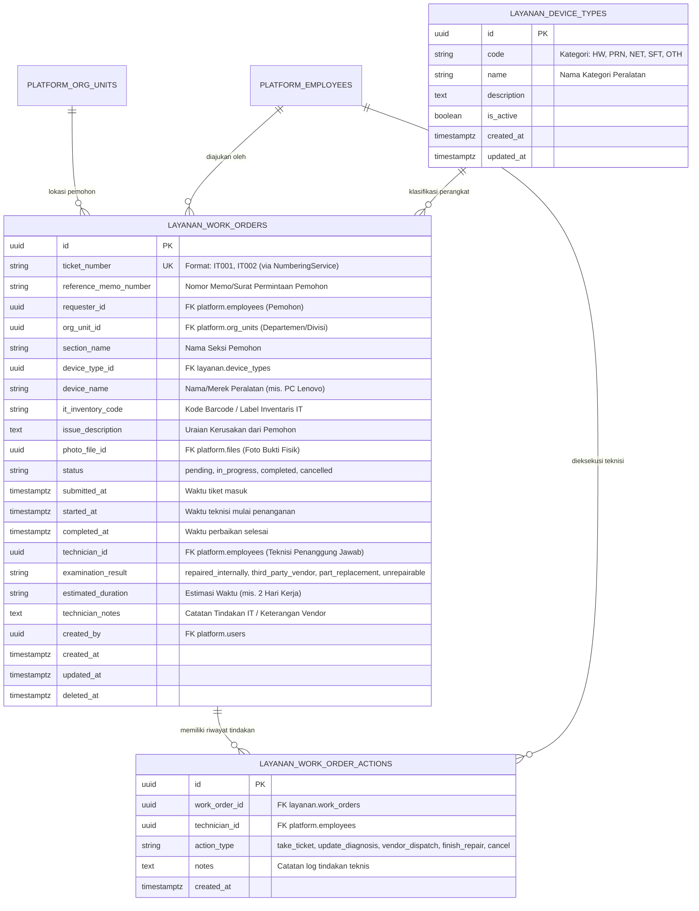
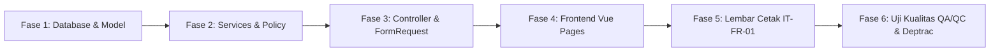

# RENCANA IMPLEMENTASI & SPESIFIKASI ARSITEKTUR
## SISTEM INFORMASI WORK ORDER PERMOHONAN PERBAIKAN IT (SI_WOPPIT)
### MODUL LAYANAN (PT KERTAS PADALARANG - PERURI SECURITY PAPER MILL)

---

| Parameter Dokumen | Informasi Spesifikasi |
| :--- | :--- |
| **Nomor Dokumen** | `PLAN-IT/PTKP-LAYANAN/WOPPIT/2026/001` |
| **Nama Sistem Target** | Modul Layanan — Work Order IT (SI_WOPPIT Rebuild) |
| **Formulir Acuan Mutu** | Standar Mutu **IT-FR-01/REV00** (01 April 2021) |
| **Teknologi Target** | Laravel 11 (Modular Monolith) + Vue 3 (Inertia.js) + PostgreSQL 16 (Schema: `layanan`) |
| **Target Pengguna** | 1. User/Pemohon (Seluruh Pegawai Lintas Unit), 2. Teknisi IT (Unit SMT & IT), 3. Supervisor/Admin IT |
| **Status Dokumen** | **PROPOSED & READY FOR IMPLEMENTATION** |

---

## 1. LATAR BELAKANG & TUJUAN BISNIS

### 1.1. Latar Belakang Transformasi
Aplikasi lama **SI_WOPPIT** berbasis PHP/MySQL (`db_cisptkp`) mengelola tiket permohonan perbaikan perangkat keras, perangkat lunak, printer, dan jaringan komputer. Walaupun telah memenuhi alur dasar formulir standar mutu **IT-FR-01/REV00**, sistem lama memiliki berbagai kelemahan arsitektur kritis yang terdokumentasi pada audit teknis:
1. **Celah Keamanan Eskalasi Peran (Mass Assignment):** Formulir edit profil mengirimkan `user_role_id` dalam *hidden field* yang dapat dimanipulasi pengguna biasa menjadi Administrator.
2. **Manipulasi Identitas Tiket (IDOR & Client Spoofing):** Formulir penambahan tiket mengirim `id_user` dari input tersembunyi browser, memungkinkan pembuatan tiket atas nama pegawai lain.
3. **Kondisi Balapan Nomor Antrean (Race Condition):** Pembangkitan nomor antrean menggunakan `SELECT max(nomor_antrian)` tanpa *lock*, berisiko menimbulkan nomor tiket duplikat saat trafik bersamaan.
4. **Ketiadaan Isolasi Data (*Data Scoping*):** Seluruh tiket dari semua departemen dapat dibaca oleh seluruh pengguna tanpa filter kepemilikan.
5. **Kebocoran File Sensitif:** Berkas `error.log` (246 MB) berada di *document root* web server lama.

### 1.2. Tujuan Pembangunan Modul Baru
1. Membangun ulang SI_WOPPIT ke dalam **Modul Layanan (`app/Modules/Layanan`)** pada ekosistem Modular Monolith PTKP.
2. Mengintegrasikan layanan bersama Platform Core:
   - **`DirectoryServiceInterface`:** Data pegawai, unit kerja, dan atasan langsung.
   - **`NumberingServiceInterface`:** Pembangkitan nomor antrean tiket `ITxxx` secara atomik anti-tabrakan.
   - **`FileServiceInterface`:** Penyimpanan bukti foto fisik kerusakan secara aman di luar *document root*.
   - **`AuditLogServiceInterface`:** Pencatatan riwayat penanganan teknis (*append-only*).
3. **Pemisahan Batas Domain yang Tegas:**
   - **Modul Layanan:** Khusus menangani permohonan layanan & perbaikan fasilitas/aset IT (SI_WOPPIT).
   - **Modul Manufaktur:** Menangani pemeliharaan mesin pabrik kertas sekuriti (CMMS/SIM NEO). Kedua sistem **tidak digabung**.

---

## 2. ARSITEKTUR BASIS DATA & SKEMA POSTGRESQL (`layanan`)

Modul Layanan menggunakan schema terisolasi `layanan` di PostgreSQL. Setiap tabel menggunakan Primary Key bertipe `UUID v4`, waktu bertipe `timestamptz`, serta mematuhi aturan isolasi Deptrac (*hanya menyimpan foreign key UUID `employee_id` dan `org_unit_id`, tidak menduplikasi nama*).



### 2.1. Skema Tabel Utama

#### 1. Tabel `layanan.device_types`
Menyimpan klasifikasi aset/perangkat IT:
* `id` (UUID, Primary Key)
* `code` (VARCHAR(20), Unique) — Contoh: `HARDWARE`, `PRINTER`, `NETWORK`, `SOFTWARE`, `OTHER`
* `name` (VARCHAR(100)) — Contoh: *Komputer & Laptop*, *Printer & Scanner*, *Perangkat Jaringan & Wi-Fi*, *Sistem & Aplikasi*
* `is_active` (BOOLEAN, Default: `true`)
* `created_at`, `updated_at` (TIMESTAMPTZ)

#### 2. Tabel `layanan.work_orders` (Entitas Tiket Transaksional)
Menyimpan tiket keluhan pemeliharaan IT sesuai Formulir IT-FR-01:
* `id` (UUID, Primary Key)
* `ticket_number` (VARCHAR(30), Unique, Indexed) — Dihasilkan secara atomik oleh `NumberingServiceInterface` (Format: `IT001`, `IT002`, dst.)
* `reference_memo_number` (VARCHAR(100), Nullable) — Nomor memo/surat pengantar unit pemohon
* `requester_id` (UUID, Indexed) — Relasi logis ke `platform.employees`
* `org_unit_id` (UUID, Indexed) — Relasi logis ke `platform.org_units`
* `section_name` (VARCHAR(150)) — Nama seksi/ruangan tempat alat berada
* `device_type_id` (UUID, Indexed, Foreign Key ke `layanan.device_types`)
* `device_name` (VARCHAR(150)) — Contoh: *"PC Desktop Lenovo ThinkCentre M70q"*
* `it_inventory_code` (VARCHAR(100)) — Nomor barcode label aset IT (misal: `IT-PC-2024-089`)
* `issue_description` (TEXT) — Keluhan/gejala kerusakan yang dialami pemohon
* `photo_file_id` (UUID, Nullable) — Relasi logis ke `platform.files`
* `status` (VARCHAR(30), Default: `'pending'`) — Nilai: `'pending'` (Menunggu Antrean), `'in_progress'` (Sedang Diproses), `'completed'` (Selesai), `'cancelled'` (Dibatalkan)
* `submitted_at` (TIMESTAMPTZ) — Tanggal dan waktu tiket diajukan
* `started_at` (TIMESTAMPTZ, Nullable) — Waktu teknisi mengambil tiket
* `completed_at` (TIMESTAMPTZ, Nullable) — Waktu perbaikan dinyatakan rampung
* `technician_id` (UUID, Nullable) — Teknisi IT yang menangani
* `examination_result` (VARCHAR(50), Nullable) — Sesuai Formulir IT-FR-01:
  - `repaired_internally` (*Dapat diperbaiki internal*)
  - `third_party_vendor` (*Perbaikan ke pihak ketiga/vendor*)
  - `part_replacement` (*Penggantian suku cadang/unit baru*)
  - `unrepairable` (*Tidak dapat diperbaiki / Usul Afkir / Write-Off*)
* `estimated_duration` (VARCHAR(100), Nullable) — Estimasi durasi (misal: *"3 Jam"*, *"2 Hari Kerja"*)
* `technician_notes` (TEXT, Nullable) — Uraian tindakan perbaikan atau kendala suku cadang
* `created_by` (UUID) — Akun pembuat tiket (`platform.users`)
* `created_at`, `updated_at`, `deleted_at` (TIMESTAMPTZ, Soft Deletes)

#### 3. Tabel `layanan.work_order_actions` (Jurnal Riwayat Penanganan)
Mencatat setiap perubahan status dan catatan teknis:
* `id` (UUID, Primary Key)
* `work_order_id` (UUID, FK `layanan.work_orders` on delete cascade)
* `technician_id` (UUID, Relasi `platform.employees`)
* `action_type` (VARCHAR(50)) — `take_ticket`, `update_diagnosis`, `vendor_dispatch`, `complete_repair`, `cancel`
* `notes` (TEXT, Nullable)
* `created_at` (TIMESTAMPTZ)

---

## 3. ATURAN HAK AKSES, PERAN & DATA SCOPING (RBAC)

Mematuhi prinsip **Server adalah satu-satunya sumber kebenaran**. Tidak ada otorisasi yang bergantung pada form hidden input atau manipulasi browser:

### 3.1. Izin Terdaftar (*Permissions*)
1. `layanan.work_order.create` — Hak mengajukan tiket keluhan perbaikan IT.
2. `layanan.work_order.view` — Hak melihat daftar dan rincian tiket.
3. `layanan.work_order.process` — Hak mengambil tiket antrean, mengisi diagnosis, dan mengupdate proses perbaikan.
4. `layanan.work_order.complete` — Hak menyelesaikan tiket dan menerbitkan lembar serah terima.
5. `layanan.work_order.manage` — Hak administratif penuh atas master peralatan, pembatalan tiket, dan analitik.

### 3.2. Kebijakan Otorisasi & Pencegahan IDOR (*Policy Scoping*)
* **User Biasa (Pemohon):**
  - Hanya dapat melihat tiket yang dibuat oleh dirinya sendiri (`requester_id == user.employee_id`) atau tiket di unit kerjanya (`org_unit_id == user.org_unit_id`).
  - Dilarang keras memicu aksi *process* atau *complete*.
* **Teknisi IT & Operator SMT:**
  - Dapat melihat seluruh antrean tiket korporat lintas departemen.
  - Berhak mengklaim tiket (*take ticket*), mengisi estimasi waktu, hasil pemeriksaan teknis, dan menutup tiket.
* **Supervisor & Admin IT:**
  - Otoritas penuh memindahkan penugasan teknisi (*reassign*), mengelola data tipe perangkat, dan membatalkan tiket bermasalah.

---

## 4. RANCANGAN ANTARMUKA PENGGUNA (UI/UX) - BRAND PERURI

Antarmuka mengadopsi identitas korporat resmi **Peruri Deep Navy (`#141A5C`)**, **PTKP Navy (`#20288E`)**, dan **Mist (`#EEF0FB`)** dengan tipografi modern Inter/Lexend:

```
resources/js/Pages/Layanan/WorkOrder/
├── Index.vue      (Katalog & Papan Antrean Tiket IT)
├── Create.vue     (Form Permohonan Perbaikan IT IT-FR-01)
├── Show.vue       (Detail Tiket, Pelacakan Status, & Meja Kerja Teknisi)
└── Print.vue      (Lembar Cetak Fisik Standar IT-FR-01/REV00 Ukuran A4)
```

### 4.1. Halaman 1: Katalog & Papan Antrean Tiket (`/layanan/work-orders`)
* **Kartu Ringkasan Metrik:**
  - Total Tiket Masuk
  - Menunggu Antrean (*Pending*) — Warna Kuning/Amber
  - Dalam Proses Perbaikan (*In Progress*) — Warna Biru/Sky
  - Selesai Diperbaiki (*Completed*) — Warna Hijau/Emerald
* **Filter Reaktif:**
  - Filter Status (*All, Menunggu Antrean, Sedang Diproses, Selesai*)
  - Filter Kategori Perangkat (*Hardware, Printer, Jaringan, Software*)
  - Filter Unit Kerja / Departemen
  - Kotak Pencarian Tiket (*Nomor Tiket, Nama Alat, atau Nama Pemohon*)
* **Tabel Antrean:**
  - Nomor Tiket (badge font mono tebal, misal `IT042`)
  - Tanggal & Waktu Masuk
  - Pemohon & Unit Kerja
  - Nama Alat & Kode Barcode IT
  - Gejala Kerusakan Ringkas
  - Status Badge & Teknisi Penanggung Jawab
  - Tombol Aksi: `Lihat Detail`, `Proses Tiket`, `Cetak Form`

### 4.2. Halaman 2: Formulir Permohonan Tiket Baru (`/layanan/work-orders/create`)
* **Identitas Otomatis Terkunci:**
  - Nama Pemohon, NIP, Departemen, dan Seksi otomatis terisi dari profil sesi login pengguna (tidak dapat diedit untuk mencegah penyamaran identitas).
* **Isian Data Permohonan:**
  - Nomor Memo/Surat Permintaan (Opsional)
  - Kategori Perangkat (*Dropdown*: PC, Laptop, Printer, Scanner, Switch/Wi-Fi, Software, dll.)
  - Nama / Merek Peralatan (Wajib, misal: *PC Lenovo V530*)
  - Nomor Label Barcode IT (Wajib, tertera di stiker unit)
  - Uraian Rinci Kerusakan / Gejala Gangguan (Textarea ramah)
  - Unggah Foto Kondisi Fisik / Tangkapan Layar Error (Komponen Drag-and-Drop aman)
* **Tombol Aksi:** `Kirim Permohonan Perbaikan` & `Batal`

### 4.3. Halaman 3: Detail Tiket & Meja Kerja Teknisi (`/layanan/work-orders/{id}`)
* **Bagian Pemohon:**
  - Pelacak Status Garis Waktu (*Timeline Stepper*): Diterima $\rightarrow$ Diperiksa $\rightarrow$ Dikerjakan $\rightarrow$ Selesai.
* **Panel Khusus Teknisi IT (Hanya muncul jika berwenang):**
  - Tombol `Ambil Tiket Ini` (mengubah status menjadi `in_progress` dan mencatat waktu mulai).
  - Formulir Diagnosis Teknis:
    - Estimasi Waktu Penanganan (*Input teks, misal: "2 Jam" atau "1 Hari Kerja"*).
    - Pilihan Hasil Pemeriksaan (*Dapat diperbaiki, Pihak ketiga, Penggantian, Tidak dapat diperbaiki*).
    - Catatan Teknis / Uraian Tindakan Perbaikan.
  - Tombol `Tandai Pekerjaan Selesai` (mencatat waktu selesai dan mengunci tiket).

### 4.4. Halaman 4: Lembar Cetak Standar IT-FR-01/REV00 (`/layanan/work-orders/{id}/print`)
* Format resmi sesuai formulir mutu PTKP:
  - Kop Surat Resmi: **PT KERTAS PADALARANG — PERURI SECURITY PAPER MILL**
  - Nomor Formulir: `IT-FR-01/REV00` (Efektif per 01 April 2021)
  - Kolom Data Pemohon & Rincian Kerusakan
  - Kolom Hasil Pemeriksaan & Rekomendasi Teknisi IT
  - Kolom Tanda Tangan Serah Terima 2 Pihak:
    1. Pemohon (Menyerahkan/Menerima kembali)
    2. Petugas IT / Teknisi Penanganan

---

## 5. RENCANA IMPLEMENTASI BERTAHAP (ROADMAP EKSEKUSI)

Pengembangan akan dieksekusi secara berurutan dan disiplin mematuhi standar *ptkp-conventions*:



### Tahap 1: Fondasi Basis Data & Model Eloquent
1. Membuat migrasi schema `layanan` dan tabel `layanan.device_types`.
2. Membuat migrasi tabel transaksional `layanan.work_orders` dan `layanan.work_order_actions`.
3. Mendaftarkan Seeder Master Data Tipe Peralatan IT dan tiket contoh (`LayananDeviceTypeSeeder`, `LayananWorkOrderSeeder`).
4. Membuat model Eloquent:
   - `App\Modules\Layanan\Models\DeviceType`
   - `App\Modules\Layanan\Models\WorkOrder`
   - `App\Modules\Layanan\Models\WorkOrderAction`

### Tahap 2: Logika Bisnis (*Service Layer*) & Otorisasi (*Policy*)
1. Membuat `WorkOrderService` di `app/Modules/Layanan/Services/`:
   - Integrasi pembangkitan nomor antrean via `NumberingServiceInterface` (Prefix: `IT`).
   - Penanganan upload bukti foto kerusakan via `FileServiceInterface`.
   - Logging audit aksi perbaikan via `AuditLogServiceInterface`.
   - Logika transisi status: `pending` $\rightarrow$ `in_progress` $\rightarrow$ `completed`.
2. Membuat `WorkOrderPolicy` di `app/Modules/Layanan/Policies/`:
   - Penegakan isolasi akses data tiket antar-unit (mencegah IDOR).
   - Validasi hak teknisi saat mengklaim dan menyelesaikan tiket.

### Tahap 3: Form Request, Controller, & Routing
1. Membuat Form Requests di `app/Modules/Layanan/Http/Requests/`:
   - `StoreWorkOrderRequest` (Validasi input keluhan & foto fisik).
   - `UpdateWorkOrderProgressRequest` (Validasi input estimasi & diagnosis teknis).
2. Membuat `WorkOrderController` di `app/Modules/Layanan/Http/Controllers/`.
3. Mendaftarkan routing pada `app/Modules/Layanan/routes.php`.
4. Mendaftarkan `LayananServiceProvider` pada `bootstrap/providers.php`.

### Tahap 4: Antarmuka Pengguna (*Frontend Vue + Inertia*)
1. Membuat `Index.vue` (Papan Antrean & Filter Tiket Layanan IT).
2. Membuat `Create.vue` (Formulir Permohonan Perbaikan IT ramah pengguna).
3. Membuat `Show.vue` (Halaman Detail, Garis Waktu, dan Meja Kerja Teknisi).
4. Menambahkan navigasi Modul Layanan pada `AppSidebar.vue` dan mengaktifkan kartu pada `Dashboard.vue`.

### Tahap 5: Lembar Cetak Resmi Form IT-FR-01/REV00 A4
1. Membuat `Print.vue` (Tata letak presisi lembar kerja serah terima IT format A4).
2. Penyesuaian CSS cetak `@media print` dengan margin 20mm, tanda air korporat, dan kolom tanda tangan serah terima.

### Tahap 6: Pengujian Mutu Komprehensif (QA & QC Gates)
1. **Pest Feature Tests:** Menulis suite pengujian lengkap (`tests/Feature/LayananWorkOrderTest.php`) mencakup:
   - Proteksi guest / unauthenticated.
   - Pembangkitan nomor antrean atomik.
   - Pencegahan IDOR tiket lintas departemen.
   - Siklus lengkap pemohon $\rightarrow$ teknisi ambil tiket $\rightarrow$ selesai.
2. **Larastan Static Analysis:** Memastikan `composer analyse` lulus Level 5 dengan 0 error.
3. **Deptrac Architecture Check:** Memastikan `composer deptrac` lulus 0 layer violation.
4. **Laravel Pint:** Memastikan gaya penulisan kode 100% PSR-12 compliant.
5. **Vite Production Build:** Memastikan bundle aset client & SSR terkompilasi bersih.

---

## 6. KRITERIA PENERIMAAN (*ACCEPTANCE CRITERIA*)

Proyek dinyatakan selesai dan siap diserahkan apabila:
- [ ] Pegawai dari unit manapun dapat mengajukan keluhan kerusakan alat IT dan memperoleh nomor antrean unik format `ITxxx`.
- [ ] Bukti foto kerusakan tersimpan dengan aman dan dapat dilihat pratinjaunya oleh teknisi.
- [ ] Teknisi IT dapat mengambil tiket, mengisi estimasi durasi penanganan, memilih salah satu dari 4 opsi hasil pemeriksaan, serta menutup tiket ke status selesai.
- [ ] Pemohon tidak dapat mengedit tiket yang sedang dikerjakan teknisi atau tiket milik orang/unit lain (Anti-IDOR).
- [ ] Lembar cetak fisik **IT-FR-01/REV00** dapat dicetak ke kertas A4 dengan tata letak rapi dan kolom tanda tangan pemohon & teknisi.
- [ ] Seluruh pengujian otomatis Pest, PHPStan (0 errors), Deptrac (0 violations), dan Pint lulus 100%.

---
*Rencana implementasi ini siap dieksekusi setelah mendapatkan konfirmasi dan persetujuan pengguna.*
